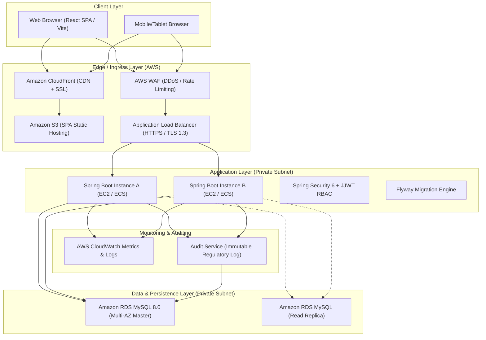

# Telecom Enterprise CRM - System Architecture & Design Specification

## 1. Executive Overview

The Telecom Customer Relationship Management (CRM) platform is a high-availability, compliant enterprise solution engineered for Tier-1/Tier-2 telecommunications service providers. It caters to concurrent operations across Customer Onboarding, Subscriber Identity Module (SIM) / eSIM Lifecycle, Telecom Plan Subscriptions, Lead Funnels, Service Desk & SLA Ticket Resolution, Invoicing & Payments, and Field Operations.

The system is designed to support 50–100+ concurrent operations with sub-100ms API response times under standard load, adhering to India's **Digital Personal Data Protection Act (DPDPA 2023)** and **DoT / TRAI (Telecom Regulatory Authority of India)** regulatory guidelines.

---

## 2. High-Level System Architecture



---

## 3. Technology Stack & Compatibility Verification

| Component | Selected Technology | Version / Specification | Rationale & Compatibility Notes |
| :--- | :--- | :--- | :--- |
| **Runtime** | Java Development Kit | **Java 27 (Oracle JDK 27)** | Verified active local installation (`build 27+35-2325`). Compiles under Java 27 bytecode with compatibility fallback flag `<java.version>27</java.version>`. |
| **Framework** | Spring Boot | **Spring Boot 3.4.x / Spring 6.2.x** | Modern Spring Boot release with comprehensive virtual thread support (Project Loom), Spring Security 6.4, Spring Data JPA 3.4, and Hibernate 6.6. |
| **Security** | Spring Security + JJWT | **0.12.6** | Stateless HMAC-SHA256 JWT, claims-based authorization, BCrypt password hashing ($2a$ at work factor 12). |
| **Persistence** | Spring Data JPA / Hibernate | **Hibernate 6.6** | Optimized connection pool (HikariCP), pessimistic/optimistic locking, explicit DTO projection. |
| **Database** | MySQL Server / H2 | **MySQL 8.0.36+ / H2 In-Memory** | Dual profile configuration: `dev` runs with fast in-memory H2 (zero local driver dependencies for immediate tests) and `mysql` runs with enterprise MySQL 8. |
| **Migration** | Flyway | **10.x** | Versioned, idempotent DDL and DML scripts tracking schema evolutions. |
| **API Docs** | SpringDoc OpenAPI | **2.6.0** | Swagger UI and OpenAPI 3.0 specification generated at `/swagger-ui/index.html`. |
| **Frontend** | React with Vite | **React 18.3, Vite 5.4, TypeScript** | Fast compilation, modern ECMAScript standard, single page architecture with modular chunks. |
| **Styling** | Tailwind CSS & Lucide Icons | **Tailwind 3.4, Lucide-React** | Responsive, dark navy-blue enterprise design system, crisp iconography. |
| **State & HTTP** | Axios & React Hook Form | **Axios 1.7, React Hook Form 7.53, Zod 3.23** | Type-safe form validation and intercepted HTTP client with bearer token management. |
| **Visuals** | Recharts | **2.12.7** | Interactive charts for executive summaries, revenue trends, SLA metrics, and lead conversions. |

---

## 4. Layered Backend Design Pattern

```
com.telecom.crm
├── config/              # SecurityConfig, CorsConfig, SwaggerConfig, AuditingConfig, JacksonConfig
├── security/            # JwtAuthenticationFilter, JwtTokenProvider, UserDetailsServiceImpl, SecurityUser
├── controller/          # REST Controllers with @PreAuthorize role guards & /api/v1 prefix
│   ├── AuthController.java
│   ├── CustomerController.java
│   ├── ConnectionController.java
│   ├── PlanController.java
│   ├── LeadController.java
│   ├── TicketController.java
│   ├── FollowUpController.java
│   ├── BillingController.java
│   ├── EmployeeController.java
│   ├── BranchController.java
│   ├── DashboardController.java
│   └── ReportController.java
├── service/             # Business interface contracts
├── service/impl/        # Transactional service implementations with boundary isolation
├── repository/          # Spring Data JPA interfaces with custom query methods & projections
├── entity/              # JPA domain entities mapped to normalized relational schema
├── dto/                 # Request/Response payloads decoupled from database entities
│   ├── auth/
│   ├── customer/
│   ├── connection/
│   ├── plan/
│   ├── lead/
│   ├── ticket/
│   ├── billing/
│   ├── employee/
│   └── dashboard/
├── mapper/              # Bidirectional entity-DTO transformation components
├── exception/           # GlobalExceptionHandler, ResourceNotFoundException, BusinessRuleException
├── validation/          # Custom validators (Indian Phone, GSTIN, PAN, Email)
├── audit/               # EntityAuditorAware, AuditLogAspect for regulated operation logging
└── scheduler/           # Automated follow-up overdue escalation & SLA breach checkers
```

---

## 5. Role-Based Access Control (RBAC) Matrix

| Module / Action | Super Admin | CRM Manager | Sales Executive | Customer Support | Billing Executive | Field Technician |
| :--- | :---: | :---: | :---: | :---: | :---: | :---: |
| **User & Role Administration** | **CRUD** | None | None | None | None | None |
| **Branch Management** | **CRUD** | Read | None | None | None | None |
| **Customer Records** | **CRUD** | **CRUD** | Create/Read/Update | Read/Update | Read | Read (Assigned) |
| **SIM / Connections** | **CRUD** | **CRUD** | Read/Create | Read/Update | Read | Read/Update Status |
| **Telecom Plans Catalog** | **CRUD** | **CRUD** | Read | Read | Read | Read |
| **Leads & Pipeline** | **CRUD** | **CRUD** | **CRUD** (Assigned) | None | None | None |
| **Support Tickets & SLA** | **CRUD** | **CRUD** | Read | **CRUD** | Read | Update Status/Notes |
| **Invoices & Payments** | **CRUD** | Read | Read | Read | **CRUD** | None |
| **Executive Reports** | **All** | **All** | Sales only | Support only | Billing only | None |
| **Audit Logs** | **Read** | None | None | None | None | None |

---

## 6. Telecom Regulatory & Security Compliance (DoT / TRAI & DPDPA)

1. **PII Masking**: Customer Mobile numbers, Aadhaar/Passport references, and alternate contacts are masked for unauthorized roles (e.g. `+91 98200-XXXXX`).
2. **Zero Plain SIM Secrets**: No Ki/OPc cryptographic secrets or one-time verification keys are ever stored in the CRM application database.
3. **Audit Trail for Regulated Operations**: Every connection activation, SIM status swap, status freeze, or customer address change triggers an asynchronous immutable entry in the `audit_logs` table capturing `performed_by`, `ip_address`, `action`, `old_value`, and `new_value`.
4. **Idempotent Billing Transactions**: Payment recording enforces idempotent transaction reference validation to strictly eliminate double-debit / double-credit anomalies.
5. **Least Privilege Database Connections**: The web application connects using a dedicated `crm_app` user without schema modification rights (`DROP`, `ALTER` restricted to Flyway migration pipeline).
