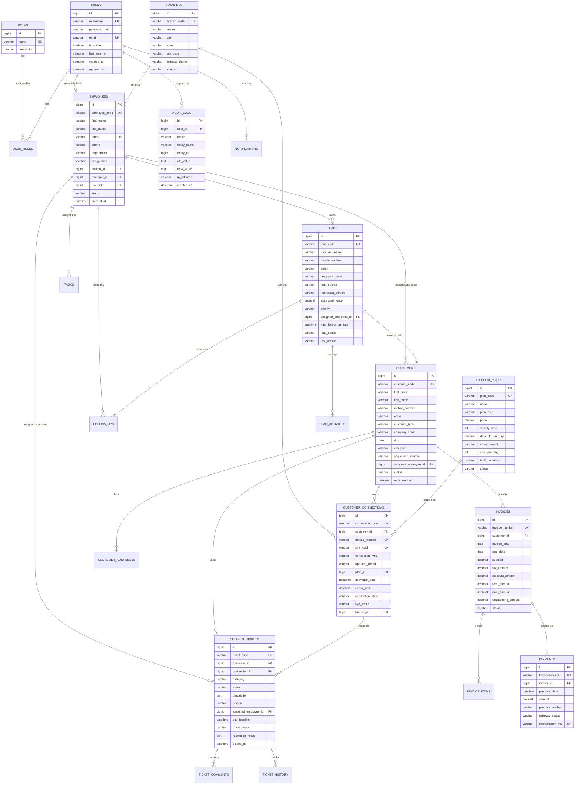

# Entity Relationship (ER) Diagram & Data Dictionary

## 1. Relational Database Overview

The Telecom CRM uses a normalized (3NF) relational design designed for high data integrity, strict auditability, and fast search indexing across millions of subscriber rows.

The schema spans 22 distinct tables:
1. `users` — System logins & authentication credentials
2. `roles` — RBAC permission groups
3. `user_roles` — Many-to-many role mappings
4. `branches` — Telecom regional circles and service offices
5. `employees` — Staff directory with manager hierarchy
6. `customers` — Subscribers (Individual & Enterprise)
7. `customer_addresses` — Billing and installation addresses
8. `telecom_plans` — Product catalog (prepaid/postpaid tariffs)
9. `customer_connections` — Subscribed MSISDN numbers, SIM/eSIM references, KYC status
10. `leads` — Prospective sales leads & deals
11. `lead_activities` — Interaction logs for leads
12. `follow_ups` — Scheduled meetings and call reminders
13. `tasks` — Work assignments and internal to-dos
14. `support_tickets` — Customer complaints and technical service requests
15. `ticket_comments` — Internal notes and customer-visible comments
16. `ticket_history` — Status transitions and SLA timestamps
17. `invoices` — Billing statements and balances
18. `invoice_items` — Itemized charges and taxes
19. `payments` — Transaction logs and gateway receipts
20. `notifications` — In-app alerts and notifications
21. `audit_logs` — Immutable regulatory audit trail
22. `company_settings` — Tenant configuration and parameters

---

## 2. Mermaid Entity-Relationship Diagram

---

## 3. High-Performance Indexing Strategy

To guarantee rapid queries for 50–100 concurrent operators, the following composite and single-column indexes are defined in migration scripts:

| Table | Index Columns | Purpose |
| :--- | :--- | :--- |
| `customers` | `mobile_number`, `status` | Lightning-fast caller lookup during customer contact |
| `customer_connections` | `mobile_number`, `sim_iccid` | Instant SIM activation / lifecycle validation |
| `leads` | `assigned_employee_id`, `lead_status` | Sales executive pipeline filtering & Kanban load |
| `support_tickets` | `ticket_status`, `assigned_employee_id`, `sla_deadline` | Real-time SLA breach alarms and desk triage |
| `invoices` | `customer_id`, `status`, `due_date` | Dunning and accounts-receivable reports |
| `payments` | `invoice_id`, `idempotency_key` | Duplicate charge prevention and audit verification |
| `audit_logs` | `entity_name`, `entity_id`, `created_at` | Rapid regulatory inspection trail retrieval |
